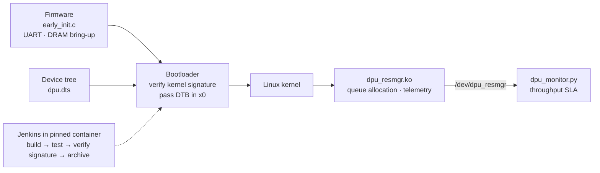

# DPU System Software Stack

**A compact, end-to-end sketch of the software that brings up an ARM-based DPU (data processing unit): firmware that initializes UART and DRAM, a bootloader that refuses unsigned kernels, a device tree, a kernel driver that hands out hardware queues and exposes telemetry, a user-space monitor, and a containerized CI pipeline that gates release on signature verification.**

Each layer of an embedded platform depends on the one below it, and the chain of trust has to hold across all of them. This repository walks that chain from power-on to deployment, one small file per layer, so the hand-offs are easy to follow.



## The layers

| Layer | File | What it does |
|---|---|---|
| Firmware | `firmware/early_init.c` | Freestanding C after reset: writes to the PL011 UART via MMIO, starts the DRAM controller, polls its ready bit with a timeout, and fail-stops with a console message on failure |
| Bootloader | `boot/bootloader.c`, `boot/boot.cfg` | Loads the kernel and device-tree blob, verifies the kernel signature, and jumps to it with the DTB pointer as the first argument (ARM64 convention); halts on an invalid signature. `boot.cfg` declares `secure_boot = enforce` and the public key |
| Device tree | `boot/dpu.dts` | Describes the DPU engine at `0x40000000` (one page of MMIO) on IRQ 42 so the kernel doesn't hard-code board details |
| Kernel driver | `kernel/dpu_resmgr.c` | `ioremap`s the engine registers; `DPU_ALLOC_QUEUE` / `DPU_FREE_QUEUE` ioctls manage a mutex-protected queue bitmap (`-EBUSY` when exhausted, `-EINVAL` for bad IDs); `read()` returns live packets/sec from a register as text |
| Monitor | `monitor/dpu_monitor.py` | Polls `/dev/dpu_resmgr` every second and flags `DEGRADED` / `ALERT` below 1,000,000 pps |
| Release gate | `secure/verify_image.sh` | Refuses an image with no detached signature or one that fails `openssl dgst -sha256 -verify` against the public key |
| Toolchain & CI | `Dockerfile`, `Jenkinsfile`, `Makefile` | Debian 12 container with the aarch64 cross-compiler and `dtc`; Jenkins stages Build → Test (sparse checks, pyflakes) → Verify signature → Archive |

[RUNBOOK.md](RUNBOOK.md) maps boot console messages and driver errors to causes and fixes, and lists the golden rules (never force-unload with queues held, never disable secure boot to get a board booting).

## Trying the pieces

The signature gate works on its own. With an RSA key pair and a detached SHA-256 signature, it accepts the signed image and rejects a tampered or unsigned one:

```bash
openssl genpkey -algorithm RSA -out key.pem -pkeyopt rsa_keygen_bits:2048
mkdir -p keys build && openssl pkey -in key.pem -pubout -out keys/dpu_kernel.pub
cp /path/to/Image build/Image
openssl dgst -sha256 -sign key.pem -out build/Image.sig build/Image

bash secure/verify_image.sh build/Image   # OK: build/Image signature verified
```

The firmware and bootloader sources compile as freestanding C (`gcc -ffreestanding -c`). The full build is designed to run inside the pinned container (see *Status* for what's still missing):

```bash
docker build -t dpu-toolchain .
docker run --rm -v "$PWD":/src dpu-toolchain make
```

## Status and limitations

This is a structural walkthrough rather than a bootable image:

- **The bootloader's platform functions** (`load_file`, `verify_signature`, `console_puts`) are declared but not implemented, and the firmware has no linker script or reset vector.
- **The build doesn't produce everything CI expects.** Nothing creates `build/` directories or a kernel `Image`, so the Verify signature stage has no input; `keys/` isn't committed; and building the module needs an arm64 kernel tree via `KDIR`.
- **`secure/verify_image.sh` isn't committed as executable**, so the Jenkins step `./secure/verify_image.sh` fails with "Permission denied"; run it with `bash` or `chmod +x` it.
- **Driver gaps:** freeing a queue doesn't check that it was allocated, and the 64-bit bitmap assumes the hardware reports at most 64 queues.
- UEFI isn't part of the code, despite appearing in earlier descriptions.
